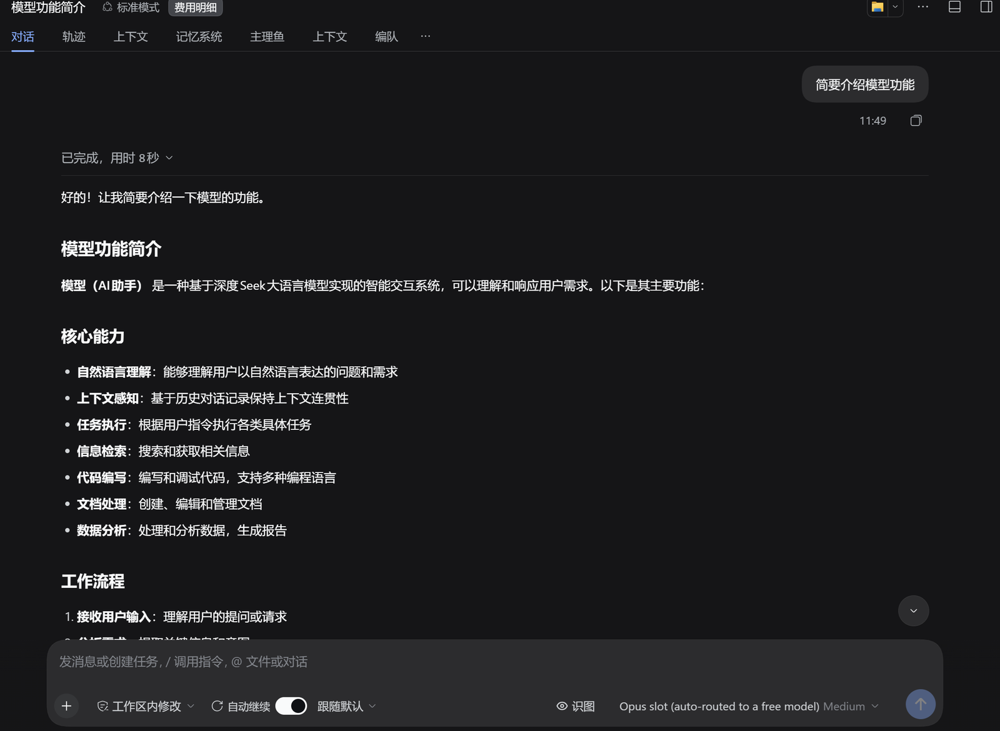
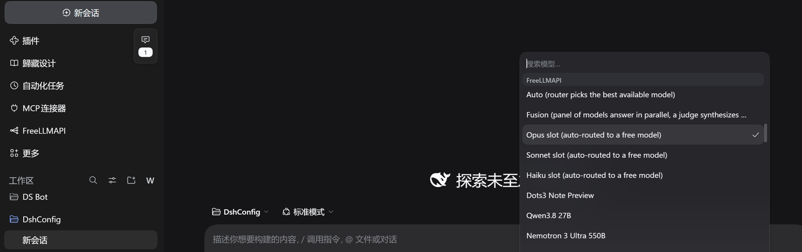
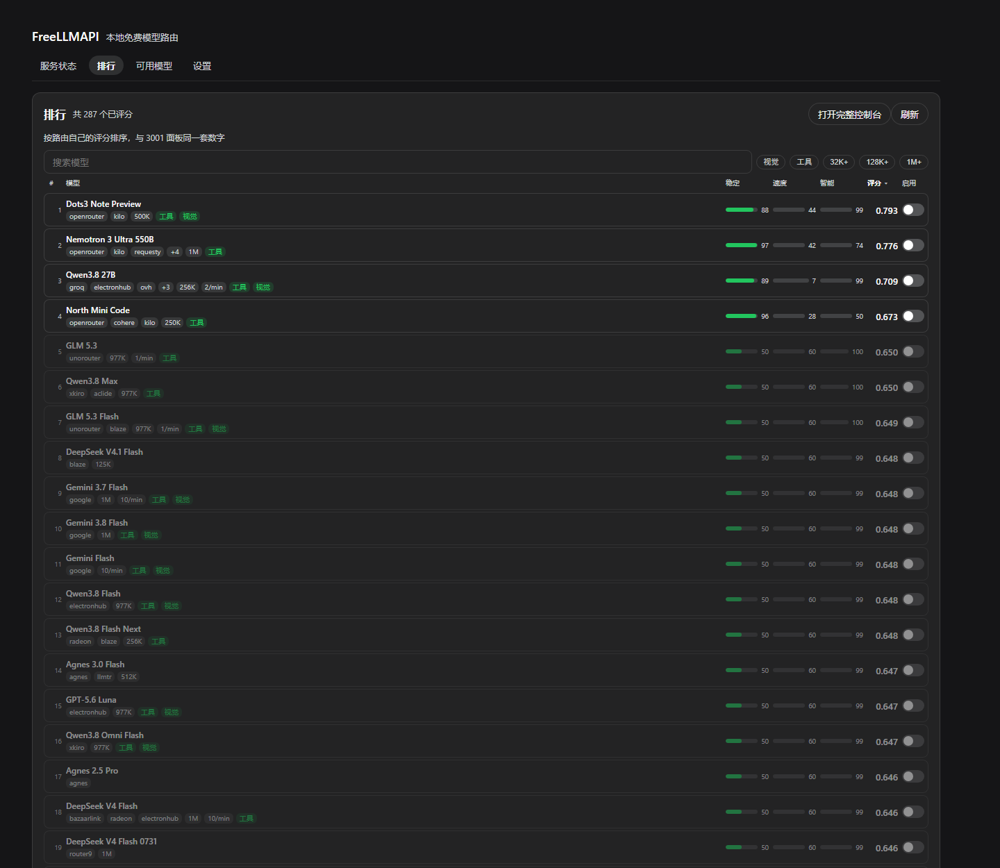
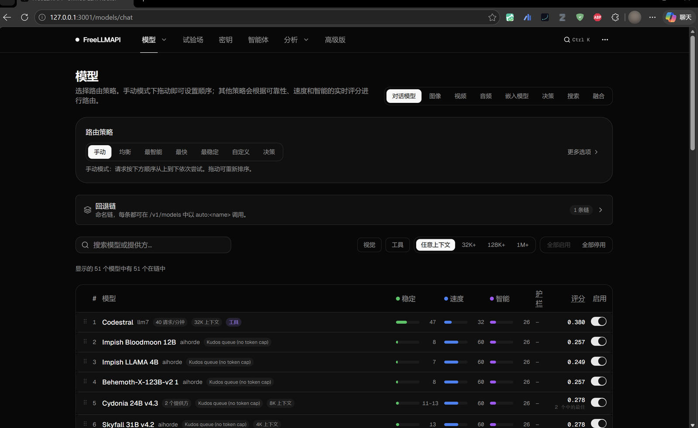

English | [中文](README.zh.md)

# dsh-freellmapi

FreeLLMAPI as a first-class model provider in DeepSeek Harness — and the router
itself ships inside the plugin, so there is nothing else to install, clone, or
build.

**A real answer, from a free model the router picked.**



**It is a normal provider.** `freellmapi` sits in the model picker next to
everything else, and every model the router reaches is one entry:



**The Ranking tab.** One row per model with a stability / speed / intelligence
bar, the combined score, the serving platforms, rate limits and context window:



**And the router's own console**, one click away, for provider keys, routing
strategy and usage — the parts a panel should not reimplement:



## What it does

- **Bundles the router.** `vendor/` carries the FreeLLMAPI server (compiled
  `server-dist`, the dashboard SPA in `client-dist`, and the 95-package runtime
  closure). The plugin launches it with the host's own binary — no system Node,
  no Docker, no `E:\...` checkout.
- Registers the provider route `freellmapi` and advertises the router's live
  catalogue. The router's own `available` flag is a database bit, not an answer,
  so the plugin probes the models it claims and drops the ones that return
  "model not found"; the panel lists both numbers and lets you tick exactly
  which ids the picker should offer. The panel is split into Status / Ranking /
  Models / Settings tabs, and the same Settings form also shows on DSH's plugin
  page.
- **Shows the router's own ranking, natively.** The **Ranking** tab draws the
  same table as the bundled dashboard's model page — one row per model with a
  stability / speed / intelligence bar, the combined score to three decimals,
  the serving platforms, rate limits and context window. It is sortable by any
  of the three axes or the score, filterable by name, vision, tools and minimum
  context window, and every row has its own enable switch plus the usual
  "enable shown" / "disable shown" bulk actions before you apply.

  The numbers are not a reimplementation: the tab opens the router's database
  read-only and computes them with the router's own `getRoutingScores()` and
  `getModelGroups()`, so the panel and <http://127.0.0.1:3001> cannot disagree.

  What the panel deliberately does not copy is the parts only the dashboard can
  own — provider keys, routing strategy, usage charts. Both the Ranking tab and
  the status card carry an **Open the full console** button for those.
- **Wears the host's theme.** Every colour in the panel is a DSH theme token
  (`--dsw-alias-*`), not a hard-coded hex, so it flips between light and dark
  together with the rest of the app. The panel also measures its own resolved
  background and sets `color-scheme` on its subtree — a native `<select>` popup
  is drawn by the OS, and without that it opens white inside a dark app.
- Lets you choose where it shows up. The Settings tab has an **Entry** picker —
  both places, sidebar only, or plugin page only. Choosing "plugin page only"
  hides the sidebar icon and embeds the model list on that page instead, so the
  plugin is never left without a way in.
- The model list sorts by name, context size, or measured availability, and
  every mode keeps the rows the picker actually offers at the top. Bulk ticking
  leads with "Tick usable" (offered or probe-answered), and all three buttons
  act on the rows the search box left visible — so "type qwen, tick usable"
  selects the working qwen models, not all 287.
- **Mints and reuses its own key.** On first boot the router generates a unified
  API key; the plugin reads it straight out of the router's SQLite database, so
  a fresh install works with zero setup. Setting `FREELLMAPI_API_KEY` overrides
  it — that is the only handle you get for rotating it deliberately.
- Starts, stops, and health-checks the router from the panel or from the
  `freellmapi` tool.
- Keeps its state under `$DSH_HOME/dsh-freellmapi/runtime/`: the SQLite database
  and the `ENCRYPTION_KEY` that decrypts the stored provider keys live together,
  so a restart never loses them.

## Setup

Install the packed tarball from the [releases
page](https://github.com/stallenlu/dsh-freellmapi/releases), or from the
[dshmarket listing](https://awesome-dsh-plugin.com/p/stallenlu/dsh-freellmapi/):

```
dsh plugin --profile web add "https://github.com/stallenlu/dsh-freellmapi/releases/download/v1.2.12/dsh-freellmapi-1.2.12.tgz"
```

**Not** `dsh plugin --profile web add github:stallenlu/dsh-freellmapi`. The git
tree does not carry `vendor/node_modules` — a 95-package runtime closure the
router needs — so a git install produces a plugin that cannot start its server.
The market page adds that GitHub line to every entry it lists; for this plugin
it is the wrong one.

1. Enable the plugin (it is a bundle: one line in the profile's `package.json`
   and one patch entry, both already written by `cordis.patch.yml`).
2. Open the **FreeLLMAPI** panel in the sidebar, press **Start**. First boot
   takes a few seconds and prints `Seeded 25 models and fallback config`. With
   `autoStart` on (the default) this also happens on its own — opening the model
   list is enough, because discovery starts the router before it asks for the
   catalogue.
3. Pick `freellmapi` as the provider and `auto` (or any catalogue id) as the
   model.
4. To actually get answers, add at least one provider key at
   <http://127.0.0.1:3001> — seven providers (aihorde, aisense, halx, keenable,
   kilo, ovh, parallel) are keyless and work immediately; the rest need your own
   signup.

## Settings

Stored in `$DSH_HOME/dsh-freellmapi/settings.json`:

| key | default | meaning |
| --- | --- | --- |
| `baseURL` | `http://127.0.0.1:3001/v1` | OpenAI-compatible base of the router; its port is what the plugin launches on |
| `requestTimeoutMs` | `300000` | per-attempt timeout; the harness maps it to `TIMEOUT` |
| `defaultMaxTokens` | `8192` | cap applied when a call sends no `max_tokens` |
| `autoStart` | `true` | start the router when the host boots |
| `proxy` | `inherit` | `inherit` follows the system proxy; `direct` sets `NO_PROXY=*` for the router |
| `probeModels` | `true` | send each claimed-available model one real request and drop the ones that answer "model not found" |
| `enabledModels` | `[]` | empty follows the probes; a non-empty list is yours — those ids and only those, dead or not |

The probe cache is `probes.json` next to the settings file, valid for 3 hours. A
429 or a timeout is a moment, not a fact, so it never removes a model — only a
404/422 does. Probing costs one short completion per model at three at a time.

`proxy` exists because the router inherits the OS proxy setting, and a proxy
whose HTTPS `CONNECT` is broken turns every upstream call into `ECONNRESET`
while the dashboard and `/v1/models` keep answering — which looks like the
router is broken. Switching to `direct` is the one-line diagnosis.

`autoStart` defaults to on because the router is part of the plugin: with it off,
the provider route is registered but answers nothing until you press Start.

A corrupt settings file fails loudly instead of silently resetting — losing a
key path quietly is worse than a visible error.

## Layout

```
lib/index.js       host half: adapter registration, tool, HTTP API, lifecycle
lib/runtime.js     bundled-router paths, ENCRYPTION_KEY bootstrap, child env
lib/adapter.js     provider adapter: catalogue, metadata, one HTTP attempt
lib/chat.js        harness message blocks -> OpenAI chat wire projection
lib/stream.js      SSE -> harness stream vocabulary, one attempt
lib/supervisor.js  router process: reachability, start, stop, key handoff
lib/store.js       settings file + credential resolution
lib/probe.js       real availability: one request per claimed model, cached verdicts
lib/ranking.js     the dashboard's ranking table, read out of the router's database
lib/kernel.js      the only @deepseek-ai/* seam (attribution user agent)
lib/client.js      browser half: sidebar panel, ranking, model list, settings
vendor/            the bundled router: server-dist, client-dist, node_modules
assets/            storefront tile and the four listing screenshots
screenshots.json   storefront images, read by the dshmarket listing
smoke.mjs          offline checks; add --live to hit a running router
```

## Why the router is vendored

Upstream ships the server as an unpublished private workspace package, its
installer requires Docker, and the desktop build is an Electron app that cannot
run headless here. Vendoring the compiled output plus its runtime closure is the
only shape that satisfies "a DSH plugin you install and use", and it keeps the
plugin honest: the adapter talks HTTP to a process it owns.

`vendor/server-dist/db/index.js` carries one local patch: `defaultDbFactory`
falls back to `node:sqlite` when `better-sqlite3` cannot be loaded, because the
host runs Node 24 (ABI 149) while the shipped native addon targets ABI 127.

## Thanks

The hard part is not mine. The router, the provider catalogue, the routing and
failover logic, the encrypted key store and the stability / speed / intelligence
scoring all come from **[tashfeenahmed/freellmapi](https://github.com/tashfeenahmed/freellmapi)**
by [Tashfeen Ahmed](https://github.com/tashfeenahmed) — tens of free LLM
providers and hundreds of free model endpoints behind a single `/v1`, plus any
custom OpenAI-compatible endpoint you point it at.

This plugin carries that work into DeepSeek Harness and gives it a panel — the
`vendor/` tree is a snapshot of upstream's compiled output, unmodified except
for the `node:sqlite` fallback noted above. If FreeLLMAPI is useful to you, the
star belongs [upstream](https://github.com/tashfeenahmed/freellmapi).

## Tests

```
node smoke.mjs           # offline: shaping, usage, finish reasons, pairing, runtime
node smoke.mjs --live    # also: real catalogue + one real completion
```

The live check needs a router on `baseURL` with a usable provider key; it skips
with a reason when either is missing.

## License

MIT. The bundled router is MIT, Copyright (c) 2026 Tashfeen Ahmed; see
`vendor/LICENSE`.
