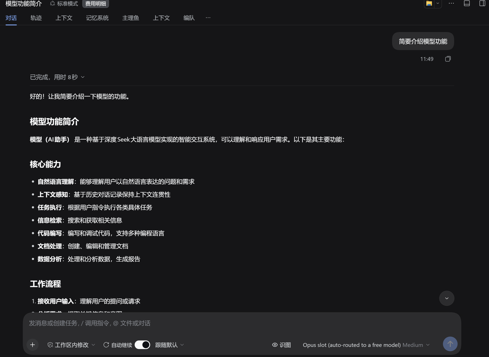
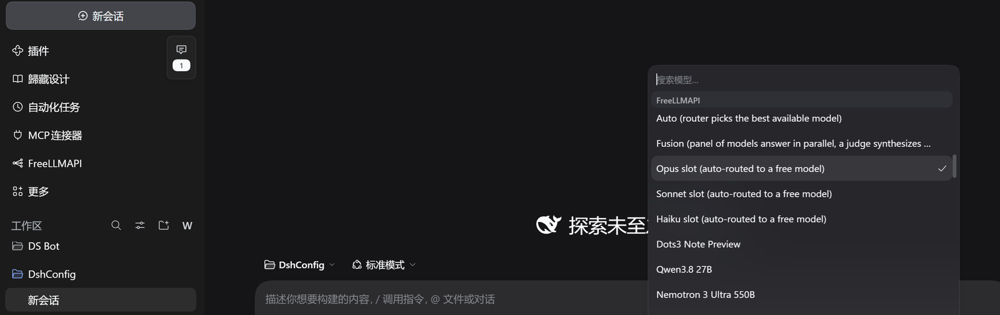
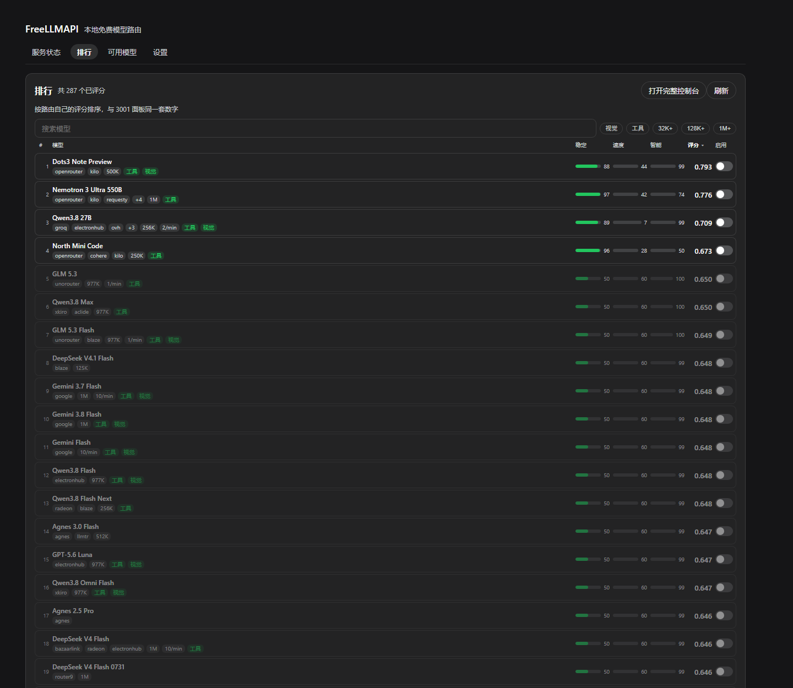
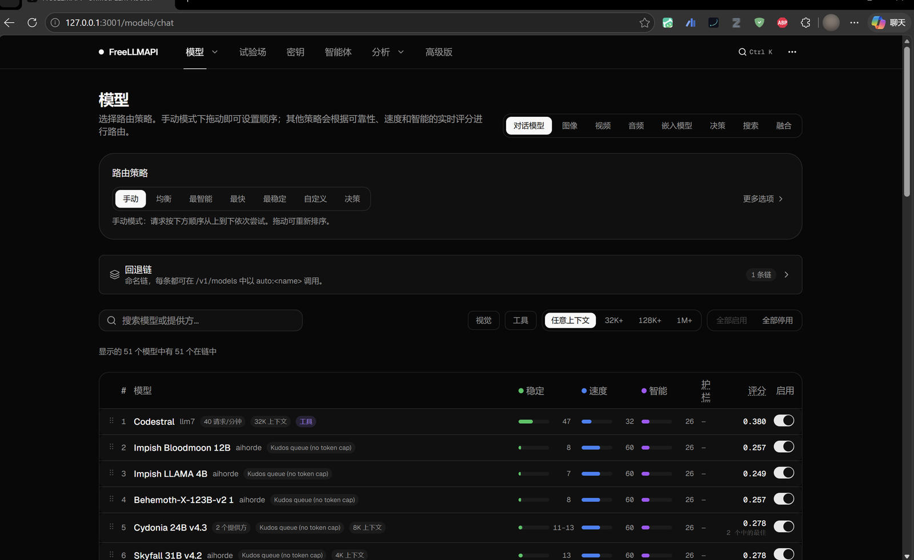

[English](README.md) | 中文

# dsh-freellmapi

把 FreeLLMAPI 做成 DeepSeek Harness 里的一等模型 provider —— 而且路由本体就随插件
打包，不用另外装、克隆或编译任何东西。

**真实的回答，来自路由器挑中的一个免费模型。**



**它就是一个普通 provider。** `freellmapi` 排在模型选择器里跟别的模型并排，路由器能碰到的每个
模型都是一个条目：



**排行页。** 一个模型一行，稳定 / 速度 / 智能三条彩条、综合评分、服务它的平台、限速与上下文
窗口：



**以及路由器自己的控制台**，一键可达，用来管 provider key、路由策略与用量 —— 这些是面板不该
重复实现的部分：



## 它能做什么

- **把路由打包进来。** `vendor/` 里带着 FreeLLMAPI 服务端（编译后的 `server-dist`、
  控制台 SPA `client-dist`，以及 95 个包的运行时闭包）。插件用**宿主自己的二进制**
  启动它 —— 不需要系统 Node、不需要 Docker，也不需要 `E:\...` 之类的源码检出。
- 注册 `freellmapi` 这条 provider 路由，并对外公布路由的实时模型目录。路由自己的
  `available` 只是数据库里的一个位，不代表真能回答，所以插件会实测它自称可用的模型、
  把回答「model not found」的剔除掉；面板同时列出这两个数，并让你精确勾选选择器要
  提供哪些 id。面板分「服务状态 / 排行 / 可用模型 / 设置」四个页签，同一份设置表单
  也会出现在 DSH 的插件页上。
- **原生显示路由自己的排行。** 「排行」页画的就是内置控制台模型页那张表 —— 一个模型
  一行，稳定 / 速度 / 智能三条彩条、三位小数的综合评分、服务它的平台、限速与上下文
  窗口。可以按三条轴或评分排序，可以按名称、视觉、工具、最小上下文窗口筛选，每行都
  有自己的启用开关，另有「启用可见 / 停用可见」批量操作，改完再统一应用。

  这些数字不是重新实现的：该页以只读方式打开路由的数据库，用路由自己的
  `getRoutingScores()` 与 `getModelGroups()` 算出来，因此面板与
  <http://127.0.0.1:3001> 不可能不一致。

  面板**刻意没有**复制的，是只有控制台才该拥有的部分 —— provider key、路由策略、
  用量图表。排行页和服务状态卡上都放了 **打开完整控制台** 按钮作为入口。
- **跟随宿主主题。** 面板里每一个颜色都是 DSH 的主题 token（`--dsw-alias-*`），
  没有硬编码的十六进制色值，所以它会跟整个应用一起在浅色/深色之间切换。面板还会
  测量自己解析后的背景色，并给自己的子树设置 `color-scheme` —— 原生 `<select>` 的
  弹层由操作系统绘制，不设它就会在深色应用里开出一块白底。
- 出现位置可选。「设置」页有一个**入口**选择器 —— 两处都有、仅侧栏、或仅插件页。
  选「仅插件页」会隐藏侧栏图标，改为把模型列表嵌在那个页面上，插件永远不会没有入口。
- 模型列表可按名称、上下文大小或实测可用性排序，每种排序都会把选择器真正会提供的行
  置顶。批量勾选的头一个是「勾选可用」（已被提供或实测有应答），三个按钮都只作用于
  搜索框筛选后**可见**的行 —— 所以「输入 qwen、点勾选可用」选中的是能用的 qwen，而不是
  全部 287 个。
- **自己生成并复用 key。** 路由器首次启动会生成一个 unified API key；插件直接从路由
  的 SQLite 数据库里把它读出来，所以全新安装零配置即可用。设置
  `FREELLMAPI_API_KEY` 可以覆盖它 —— 那也是你唯一能主动轮换它的把手。
- 从面板或从 `freellmapi` 工具启动、停止、做健康检查。
- 状态放在 `$DSH_HOME/dsh-freellmapi/runtime/`：SQLite 数据库与解密已存 provider key
  的 `ENCRYPTION_KEY` 放在一起，所以重启永远不会把它们弄丢。

## 安装

从 [releases 页](https://github.com/stallenlu/dsh-freellmapi/releases)装打包好的
tarball，或从 [dshmarket 条目](https://awesome-dsh-plugin.com/p/stallenlu/dsh-freellmapi/)
进：

```
dsh plugin --profile web add "https://github.com/stallenlu/dsh-freellmapi/releases/download/v1.2.9/dsh-freellmapi-1.2.9.tgz"
```

**不要**用 `dsh plugin --profile web add github:stallenlu/dsh-freellmapi`。git 源码树
里没有 `vendor/node_modules` —— 那是路由器赖以运行的 95 包运行时闭包 —— 所以从 git
安装会得到一个起不来服务端的插件。市场页会给它收录的每个条目都附上那行 GitHub 安装
方式；对这个插件来说，那是错的那条。

1. 启用插件（它是一个 bundle：profile 的 `package.json` 一行，加一条 patch 条目，
   都由 `cordis.patch.yml` 写好了）。
2. 在侧栏打开 **FreeLLMAPI** 面板，按 **Start**。首次启动要几秒，会打印
   `Seeded 25 models and fallback config`。开着 `autoStart`（默认）时它也会自己起 ——
   打开模型列表就够了，因为发现流程会在要目录之前先把路由器拉起来。
3. provider 选 `freellmapi`，model 选 `auto`（或目录里的任意 id）。
4. 要真的拿到回答，得先在 <http://127.0.0.1:3001> 加至少一个 provider key —— 有七个
   （aihorde、aisense、halx、keenable、kilo、ovh、parallel）免密钥、装上即用；其余
   需要你自己注册。

## 设置

存在 `$DSH_HOME/dsh-freellmapi/settings.json`：

| 键 | 默认值 | 含义 |
| --- | --- | --- |
| `baseURL` | `http://127.0.0.1:3001/v1` | 路由器的 OpenAI 兼容地址；它的端口就是插件启动时用的端口 |
| `requestTimeoutMs` | `300000` | 单次尝试超时；harness 会把它映射成 `TIMEOUT` |
| `defaultMaxTokens` | `8192` | 请求没带 `max_tokens` 时套用的上限 |
| `autoStart` | `true` | 宿主启动时就把路由器拉起来 |
| `proxy` | `inherit` | `inherit` 跟随系统代理；`direct` 给路由器设 `NO_PROXY=*` |
| `probeModels` | `true` | 对每个自称可用的模型发一次真实请求，把回答「model not found」的剔除 |
| `enabledModels` | `[]` | 空 = 跟随实测；非空 = 以你为准，就这些 id，死的也照给 |

实测缓存是设置文件旁边的 `probes.json`，有效期 3 小时。429 和超时只是「此刻」而不是
「事实」，所以永远不会因此移除模型 —— 只有 404/422 才会。实测代价是每个模型一次短补全，
并发三个。

`proxy` 之所以存在，是因为路由器会继承操作系统代理设置：代理的 HTTPS `CONNECT` 一旦
坏了，所有上游调用都变成 `ECONNRESET`，而控制台和 `/v1/models` 照常应答 —— 看起来就
像路由器坏了。切到 `direct` 就是那一行诊断。

`autoStart` 默认开着，因为路由器是插件的一部分：关掉它，provider 路由注册着但你不按
Start 就什么都不答。

设置文件损坏时会**响亮地报错**而不是悄悄重置 —— 悄悄丢掉 key 的存放路径，比一个看得见
的错误更糟。

## 目录结构

```
lib/index.js       host 半边：适配器注册、工具、HTTP API、生命周期
lib/runtime.js     内置路由路径、ENCRYPTION_KEY 引导、子进程环境变量
lib/adapter.js     provider 适配器：目录、元数据、单次 HTTP 尝试
lib/chat.js        harness 消息块 -> OpenAI chat 线格式投影
lib/stream.js      SSE -> harness 流式词表，单次尝试
lib/supervisor.js  路由进程：可达性、启动、停止、key 交接
lib/store.js       设置文件 + 凭据解析
lib/probe.js       真实可用性：每个自称可用模型一次请求，结论缓存
lib/ranking.js     控制台那张排行表，从路由数据库里读出来
lib/kernel.js      唯一一处 @deepseek-ai/* 接缝（归属用 user agent）
lib/client.js      浏览器半边：侧栏面板、排行、模型列表、设置
vendor/            打包进来的路由器：server-dist、client-dist、node_modules
assets/            商店图标与截图
screenshots.json   商店图片，由 dshmarket 条目读取
smoke.mjs          离线检查；加 --live 会打真实路由器
```

## 为什么把路由器打包进来

上游把服务端作为**未发布的私有 workspace 包**发布，它的安装器要 Docker，桌面版是个在
这里跑不了 headless 的 Electron 应用。把编译产物连同它的运行时闭包一起 vendored 进来，
是唯一能满足「一个装上就能用的 DSH 插件」的形状，而且它让插件保持诚实：适配器只是在跟
一个自己拥有的进程讲 HTTP。

`vendor/server-dist/db/index.js` 带一处本地补丁：`defaultDbFactory` 在
`better-sqlite3` 加载不了时回退到 `node:sqlite`，因为宿主跑的是 Node 24（ABI 149），
而随包的原生 addon 面向 ABI 127。

## 致谢

难的那部分不是我做的。路由器、provider 目录、路由与失败转移逻辑、加密的密钥库，以及
稳定 / 速度 / 智能这套评分，全部来自
**[tashfeenahmed/freellmapi](https://github.com/tashfeenahmed/freellmapi)**
（作者 [Tashfeen Ahmed](https://github.com/tashfeenahmed)）—— 几十个免费 LLM provider、
几百个免费模型端点，统一在一个 `/v1` 后面，另外还能接任何自定义的 OpenAI 兼容端点。

这个插件做的事，是把那份工作带进 DeepSeek Harness 并给它一个面板 —— `vendor/` 是上游
编译产物的快照，除上面那处 `node:sqlite` 回退外未作修改。如果 FreeLLMAPI 对你有用，
那颗 star 应该给[上游](https://github.com/tashfeenahmed/freellmapi)。

## 测试

```
node smoke.mjs           # 离线：形状、用量、结束原因、配对、运行时
node smoke.mjs --live    # 另外：真实目录 + 一次真实补全
```

真实检查需要 `baseURL` 上有一个带可用 provider key 的路由器；缺任一项时会带原因跳过。

## 许可

MIT。内置的路由器是 MIT，Copyright (c) 2026 Tashfeen Ahmed；见
`vendor/LICENSE`。
